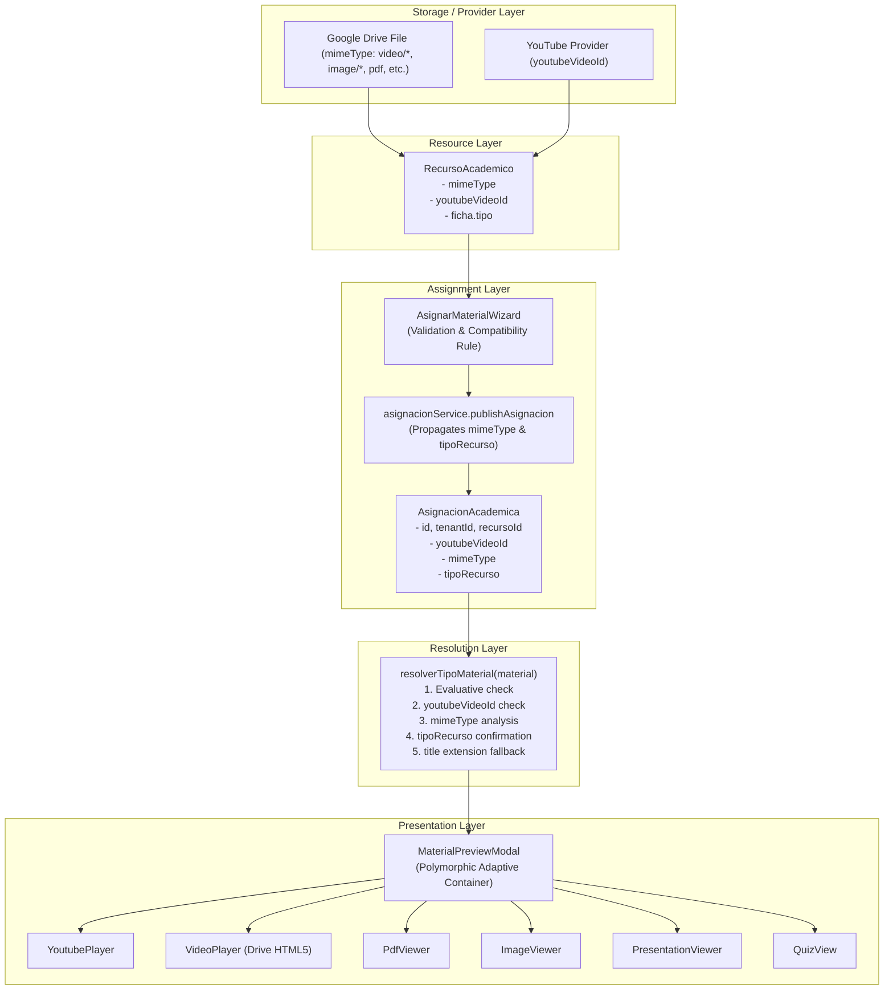

# Design: Adaptive Material Preview & Fail-Safe Material Type Resolution

## Architecture Overview



## Detailed Component Specifications

### 1. Model Updates (`models/academico/asignacion.ts`, `models/academico/asignacionService.types.ts`)
- Add fields to `AsignacionAcademica`:
  - `mimeType?: string;`
  - `tipoRecurso?: 'video' | 'pdf' | 'imagen' | 'presentacion' | 'quiz' | 'documento' | 'otro';`
- These fields are optional for backward-compatibility with historical records, but populated for all published assignments when an underlying `RecursoAcademico` exists.

### 2. Pure Resolver: `utils/academico/resolverTipoMaterial.ts`
Export function `resolverTipoMaterial(input: ParametrosResolucionMaterial): TipoMaterialResuelto` where:
```typescript
export type TipoMaterialResuelto = 'video' | 'pdf' | 'imagen' | 'presentacion' | 'quiz' | 'generico';

export interface ParametrosResolucionMaterial {
  uso?: string;
  youtubeVideoId?: string | null;
  mimeType?: string | null;
  tipoRecurso?: string | null;
  titulo?: string | null;
  externalFileId?: string | null;
  duracionSegundos?: number | null;
}
```
Resolution logic:
1. `if (uso === 'evaluacion' || tipoRecurso === 'quiz') return 'quiz';`
2. `if (Boolean(youtubeVideoId) || mimeType?.startsWith('video/') || tipoRecurso === 'video' || duracionSegundos !== undefined) return 'video';`
3. `if (mimeType?.includes('pdf') || tipoRecurso === 'pdf') return 'pdf';`
4. `if (mimeType?.startsWith('image/') || tipoRecurso === 'imagen') return 'imagen';`
5. `if (mimeType?.includes('presentation') || mimeType?.includes('powerpoint') || tipoRecurso === 'presentacion') return 'presentacion';`
6. Fallback to file extension in `titulo`.
7. Final safe fallback: `'generico'`.

### 3. Fail-Safe Assignment Validation in `asignacionService.ts` & `AsignarMaterialWizard.tsx`
- In `publishAsignacion`:
  ```typescript
  return {
    ...asignacion,
    recursoId: recurso.id,
    externalFileId: recurso.externalFileId,
    youtubeVideoId: recurso.youtubeVideoId ?? null,
    mimeType: recurso.mimeType,
    tipoRecurso: recurso.ficha?.tipo ?? (recurso.youtubeVideoId ? 'video' : undefined),
    ...
  };
  ```
- In `AsignarMaterialWizard.tsx`:
  - When a material is selected, verify consistency and display the appropriate icon and description based on `resolverTipoMaterial`.

### 4. Adaptive Presentation in `MaterialPreviewModal.tsx`
- Use `resolverTipoMaterial(asignacion)` instead of `detectarTipoMaterial`.
- Introduce dedicated visual branches:
  - `video` with `youtubeVideoId`: `<YoutubePlayer ... />`
  - `video` without `youtubeVideoId`: `<VideoPlayer ... />`
  - `pdf`: `<PdfViewer ... />`
  - `imagen`: Adaptive `` with zoom/fullscreen control.
  - `presentacion`: Informative presentation card with download/open capability.
  - `quiz`: `<QuizView ... />`
- Adapt header tag: "VIDEO", "DOCUMENTO PDF", "IMAGEN", "EVALUACIÓN / QUIZ", "MATERIAL DE ESTUDIO".
